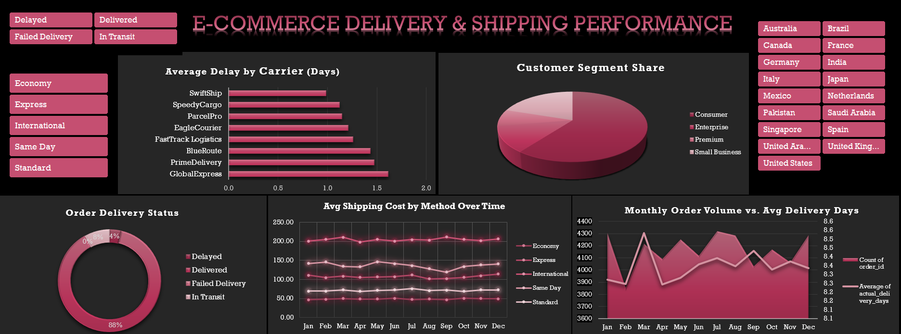

# E-Commerce Delivery & Shipping Performance Dashboard

An interactive dark-themed Excel dashboard tracking logistics efficiency, carrier delays, and shipping costs across international markets.

## Overview
Built with Microsoft Excel to give operational visibility into e-commerce fulfillment. It pairs order volumes against delivery speed and benchmarks carrier reliability to expose logistics bottlenecks.

## Key Features
* Dynamic multi-column slicers for real-time filtering by status, shipping method, and country
* Dual-axis combo chart tracking monthly order volumes against delivery turnaround times
* Carrier delay benchmarking across 8 global logistics partners
* Fulfillment distribution and customer segment share breakdowns
* Protected sheet layout preserving formulas while keeping interactive controls active

## Files
* `E-Commerce_Delivery_Performance_Dashboard.xlsx` — Main workbook
* `dashboard.png` — Dashboard preview
